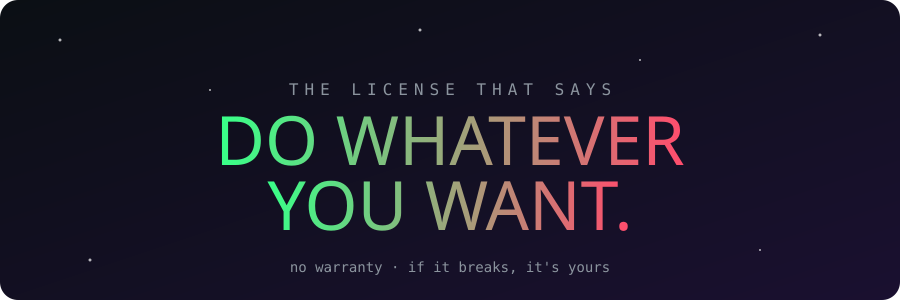
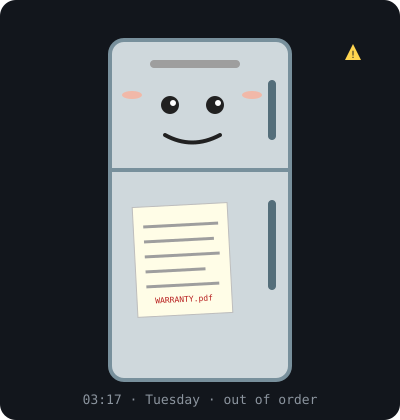
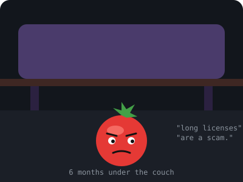
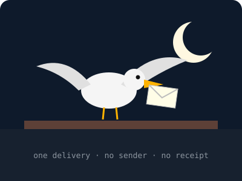

<div align="center">

**🌐 English** · [Português (BR)](./README_pt.md)




</div>

---

## 📼 Classified file: the origin

> **Location:** apartment with no number  
> **Date:** a Tuesday  
> **Time:** 03:17 AM  
> **Witnesses:** 1 fridge, 1 tomato, 1 seagull (did not testify)

### Chapter 1: The fridge

It all started with a fridge that didn't cool.

Taped to the door was an eleven-page warranty contract. Nobody had read it. On the third night of silence, the fridge cleared its throat, and those who heard it say the voice belonged to a lady who owned a notary office in 1974.

<p align="center"></p>

> *"You spend your lives writing paragraphs nobody understands. If someone is going to be responsible for something, let it be whoever wrote the code."*

The author tried to argue. He cited Apache. He cited the GPL. The fridge turned off its inner light, on purpose, just so he could feel it.

### Chapter 2: The tomato

As a final answer, the fridge dropped a tomato-shaped magnet. It fell, bounced twice and rolled under the couch.

<p align="center"></p>

The tomato stayed there for **six months**. During that time, the author realized the tomato had an opinion about software licenses, and that this opinion was *exactly the same as his*. Nobody knows how. The tomato declines to comment.

### Chapter 3: The seagull

One morning, a seagull flew in through the window, left an envelope on the sill and flew away without asking for a tip, a signature or a tax ID.

<p align="center"></p>

Inside the envelope, in green ink, a single sentence:

```
DO WHATEVER YOU WANT.
```

The author read it. Read it again. Looked at the tomato. The tomato, from under the couch, said nothing, which, coming from him, meant *yes*.

---

## 📜 The license

It's in the [`LICENSE`](./LICENSE) file. It has two lines.

```
DO WHATEVER YOU WANT WITH THIS SOFTWARE.

NO WARRANTY. IF IT BREAKS, IT'S YOURS.
```

## 🧭 How to use it

| You want to...          | Can you?        |
| ----------------------- | --------------- |
| Use it                  | Yes             |
| Copy it                 | Yes             |
| Modify it               | Yes             |
| Fork it                 | Yes             |
| Contribute              | Yes             |
| Sell it                 | Yes             |
| Complain about warranty | What warranty?  |
| Talk to the fridge      | At your own risk |

<details>
<summary><b>❓ FAQ (click if you dare)</b></summary>

**Is this a real license?**  
It has text, it has a copyright line and it has a seagull behind it. Good enough for me.

**Can I use it in a commercial project?**  
`DO WHATEVER YOU WANT`. It's right there.

**Do I have to credit the author?**  
No. But the tomato would appreciate it.

**What if the software has problems?**  
Second line of the license.

**Was the fridge fixed?**  
No. It says it's doing great.

</details>

---

<div align="center">

<sub>No tomatoes, seagulls or fridges were harmed during the creation of this license.</sub>

</div>
